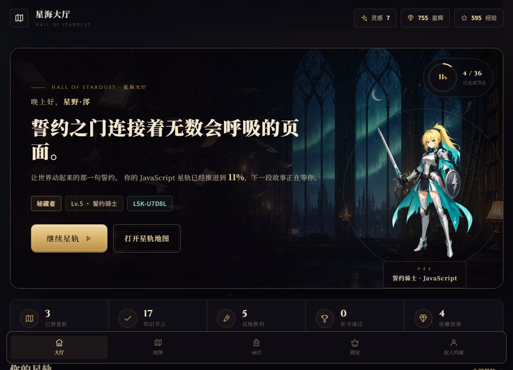
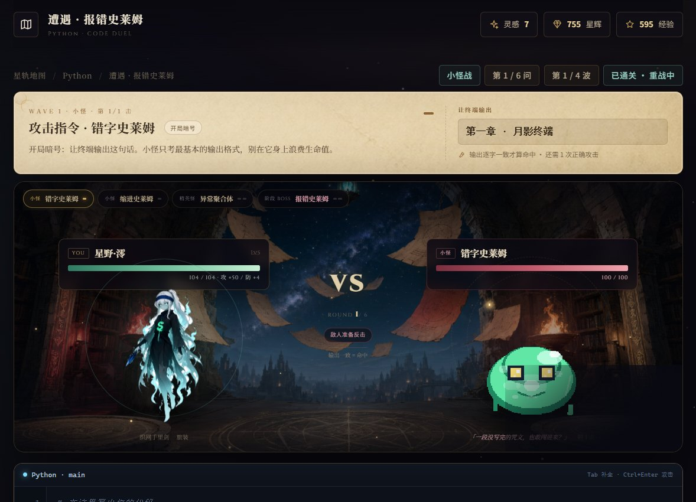
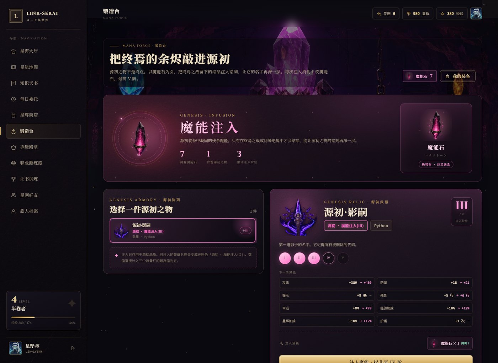
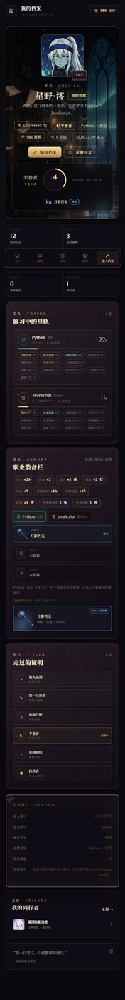

# LINK-SEKAI 代码游戏

### リンクせかい · Code Link-Sekai

> 把终端当法杖，把逻辑当咒文。  
> 一个把编程学习写成异世界冒险的网页游戏。

作者：**龙潜猫隐**

> 切换 AI 或交给其他平台继续开发前，请先读 [AI_HANDOVER.md](AI_HANDOVER.md)：里面有完整结构、云端接口、构建发布流程与硬约束；任何结构改动都要同步更新它。



| 战斗 | 锻造 |
| --- | --- |
|  |  |

| 手机档案 |
| --- |
|  |

---

## 在线游玩

- 星港门户（官方站点，进入游戏请从这里走）：[link-sekai-ot4mp9chy59.qoder.zone](https://link-sekai-ot4mp9chy59.qoder.zone)
- 网页版直达：[link-sekai-ot4mp9chy59.qoder.zone/play/index.html](https://link-sekai-ot4mp9chy59.qoder.zone/play/index.html)
- 官网镜像（同一份内容）：[link-sekai-official-ot4mp9chy59.qoder.zone](https://link-sekai-official-ot4mp9chy59.qoder.zone)
- 安卓 APK 与 Windows 安装包：官网下载区（APK 站内托管；Windows 安装包托管在 GitHub Release，下载卡提供香港、国内、备用三条加速线路）
- 备用整包：[GitHub Releases](https://github.com/EliasNeko/LINK-SEKAI/releases/latest)

原地址现在先打开官方站点，网页游戏统一在 `/play/` 入口（直达 `/play/index.html`）。三端共用同一套云端账号与存档，客户端内嵌同一入口，内容更新无需重新安装。

Windows 安装包约 72 MB，超过站点单文件上限，所以站点只托管 APK，EXE 放在 GitHub Release；官网下载卡另外给出几条开源加速节点（`hk.gh-proxy.com`、`ghproxy.net`、`gh-proxy.com`），国内直连 GitHub 超时时可以换线下载。改版安装包时更新 `official/js/site.js` 里的 `RELEASE_BASE` 与三个文件名，并把新附件传到对应的 Release。

---

## 这是什么

《代码 Link-Sekai》是我一个人做的编程学习游戏。

你以“旅人”的身份进入星海，从 Python、Java、C、C++、JavaScript、Go 六条星轨里选一条出发。每一关都像一段短剧情：读一点知识、写一点代码、打一场战斗，然后继续往下一座浮岛走。

我不想把它做成“看视频 + 做选择题”的课程。它更像一本可以动手玩的轻小说：终端是法杖，代码是咒文，答对题就是打出伤害，答错就会被反击。学语言的部分也在里面——剧情、对话、知识天书和考级，都尽量写成能读进去的样子。

## 现在能玩到什么

- **六条语言星轨**：Python / Java / C / C++ / JavaScript / Go，各自有职业英雄、剧情搭档、章节关卡与最终首领。
- **真正能跑的代码终端**：内置编辑器与代码沙盒，不是假装输入；运行结果会直接影响战斗。
- **星海演武场**：随时打开自由练习，只练已点亮的语言；编辑器、终端、英文报错 + 中文译注，外加一本可搜索、可插入、可运行的随身知识天书。
- **新手引导「蒂娅」**：新账号用八步引导介绍玩法、战斗、装备、咒式、成长与工具，可以跳过，之后也能在档案页回顾。
- **回合制代码战斗**：攻击、受击、Boss 多阶段、连击与技能特效，桌面和手机都能玩。
- **咒式约束**：精英与 BOSS 会检查指定语法；只打印答案会被格挡并遭反击，题卡会醒目标出必须使用的写法。
- **阶段觉醒立绘**：每条星轨的二阶 / 三阶都有专属站姿、攻击与受击立绘，熟练度达标后战斗与档案同步换装。
- **装备与锻造**：武器、服饰、道具三类装备，八档品质，源初装备可以注入魔能，最高五阶。
- **成长与收集**：等级、星辉、灵感、每日任务、熟练度、称号、图鉴与考级。
- **星网好友**：用旅人编号添加同行者，查看对方的档案与进度。
- **云端存档**：线上版本注册后，账号与进度保存在云端；换设备登录可以接着玩。

## 在线游玩

> 星港门户：<https://link-sekai-ot4mp9chy59.qoder.zone>  
> 网页游戏：<https://link-sekai-ot4mp9chy59.qoder.zone/play/index.html>

线上版本使用独立账号系统：每个玩家有自己的登录账号、旅人编号（UID）和一份互不覆盖的存档。账号名与 UID 都由服务端判重，并发注册也不会产生重复账号。登录账号是注册时填写的英文 / 数字 / 下划线账号，不是游戏昵称。

## 本地运行

项目是纯静态前端，没有构建步骤，也不需要安装依赖：

```bash
# 方式一：直接双击 index.html
# 方式二：起一个本地静态服务器（推荐，行为和线上更接近）
python -m http.server 8123
```

然后打开 <http://localhost:8123> 玩源码版网页游戏。想预览线上结构（官网在根、游戏在 `/play/index.html`），先运行 `python tools/build-portal.py`，再在 `dist` 目录起静态服务器。

本地模式（包括直接打开 `file://`）会把账号与进度保存在浏览器的 `localStorage` 里，不联网也能玩。线上版本才会启用云端账号与同步。

无论线上还是本地，都必须先注册并登录自己的账号才能进入游戏，没有游客或演示身份。测试时请在 `localhost` 上注册一个专用测试账号，不要使用正式玩家的账号，也不要在 `file://` 下清空或覆盖真实存档。

## 云端存档是怎么做的

- 账号密码使用 PBKDF2-HMAC-SHA256（60 万次迭代）加盐派生，数据库里不保存明文。
- 登录状态是一枚随机令牌，服务端只保存它的 SHA-256 摘要；Cookie 使用 `HttpOnly`、`Secure`、`SameSite=Lax`。
- 每个账号只能读写自己的存档，身份来自服务端自己的会话，不信任前端提交的 UID。
- 存档写入带版本号做 CAS；两台设备同时写入时会先合并进度，再以最新版本重推，尽量避免任何一方的肝度蒸发。

后端代码在 `functions/`，数据库结构在 `sites/schema.sql`，本地契约测试在 `dev/cloud-check.mjs`。

## 项目结构

```text
index.html            页面入口
css/                  视觉样式
js/core/              工具、账号存档、云端同步、角色立绘
js/data/              六语言课程、关卡、装备、称号、公告
js/views/             大厅、星轨、战斗、档案、商店、锻造等页面
assets/               压缩后的 WebP 美术资源
functions/            云端账号与存档接口
sites/schema.sql      数据库表结构
dev/                  后端契约测试
tools/                构建、截图与浏览器巡检脚本
dist/                 构建产物（不提交，部署时生成）
```

构建发布目录：

```bash
python tools/build-dist.py
```

会把源码和 WebP 素材整理进 `dist/`，当前整包约 9 MB。

## 开源声明

**这个项目完全开源。**

网站、源代码、剧情文本、关卡数据与美术资源都公开在这里，任何人都可以免费游玩、阅读、修改和分发，也可以把它带进课堂、社团、语言角，或者某个只想写点东西的深夜。

它公开供**社会语言学习者娱乐、练习与二次创作**使用。你可以拿它学语言、学编程，做自己的分支版本，也可以只是单纯地玩。

我只有一个请求：**不要把它包装成付费课程去贩卖，也不要用它做伤害别人的事。** 除此之外，去玩吧，去改吧，去把它变成你自己的星海。

<sub>制作备注：本项目的情节与教材部分由 Qoder 搭载 DeepSeek V4.1 Flash 辅助完成；故事、总体构造，以及代码的编写、编译、检查与修复，均由个人完成。</sub>

## 授权

代码与项目内原创内容采用 [MIT License](LICENSE)。

字体通过 Google Fonts 加载，归各自字体作者所有；如果你要商用或二次分发，请自行确认第三方资源的授权。

## 一些说明

这是一个个人项目，更新会按我的节奏来。遇到 bug、想加一条星轨、或者只是想聊聊，欢迎开 Issue。

—— 龙潜猫隐
